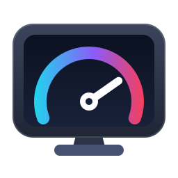

# Monitor OC



Raise your screen's refresh rate on Linux, then check that it really works.

- **Built-in screens of gaming handhelds** in SteamOS Game Mode and Bazzite: ROG Ally and Ally X,
  Steam Deck, Legion Go and others. For example, the ROG Ally X's 120 Hz panel can be offered at
  125, 130 Hz or more in the Quick Access refresh-rate slider, if your panel can handle it.
- **External monitors** on SteamOS (docked), Bazzite, Fedora and most other distros, in Game Mode
  and on every desktop.

Monitor OC is an app and a command-line tool (`monitor-oc`) in a single file. You try every new
rate before keeping it, and a trial undoes itself if the screen goes dark.

> **Overclocking a screen is at your own risk.** Most panels either work at a higher rate, drop
> frames, or show a black screen. Monitor OC always lets you test before keeping a rate, and you
> can always go back to stock. Go up in small steps.

## Install

Everything installs into your home directory: no `sudo`, no password, nothing on SteamOS's
read-only system, so it survives SteamOS updates.

### One line in a terminal

On SteamOS, switch to Desktop Mode and open **Konsole**. Then paste:

```sh
curl -fsSL https://raw.githubusercontent.com/Ravenor907/monitor-oc/main/install.sh | sh
```

[`install.sh`](install.sh) downloads the latest release, checks its SHA-256 checksum and runs
`monitor-oc install`, which adds:

- `~/.local/bin/monitor-oc`, the program
- **Monitor OC** in your app menu, with its icon

Run it again at any time to update. To install a specific release instead of the latest, put
`MONITOR_OC_VERSION=v0.2.0` in front of `sh`.

### Double-click installer

Like Decky Loader's installer: download
[Install-Monitor-OC.desktop](https://github.com/Ravenor907/monitor-oc/releases/latest/download/Install-Monitor-OC.desktop)
in Desktop Mode, drag it onto the desktop and double-click it. It opens a terminal, runs the same
one-liner and waits for Enter. If your desktop asks whether to trust or run the file, allow it.

### Manual download

Download a file from the [Releases](https://github.com/Ravenor907/monitor-oc/releases)
page, then install it:

```sh
chmod +x monitor-oc-x86_64
./monitor-oc-x86_64 install
```

| File | What it is |
|---|---|
| `monitor-oc-x86_64` | The app and the command line. Built on Ubuntu 22.04, so it needs glibc 2.35 or newer; current SteamOS, Bazzite and Fedora releases have that. |
| `monitor-oc-x86_64-musl` | Command line only, fully static: runs on any x86_64 Linux. It does not add a menu entry. |

Each file has a `.sha256` next to it (`sha256sum -c monitor-oc-x86_64.sha256`).

### First launch

- **Desktop Mode / any desktop:** open **Monitor OC** from the app menu, or run `monitor-oc` with
  no arguments (`monitor-oc gui` does the same).
- **Game Mode (SteamOS, Bazzite):** add it to Steam once. In Desktop Mode open Steam, choose
  **Games > Add a Non-Steam Game to My Library**, tick **Monitor OC** and click **Add Selected
  Programs**. In Game Mode it is then in your library under Non-Steam. On a handheld the
  touchscreen is the easiest way to use it.
- If you would rather use a terminal: `monitor-oc --help` lists every command, and
  `monitor-oc doctor` checks whether your system is ready (see [Diagnostics](#diagnostics)).

If `~/.local/bin` is not on your PATH (the default on SteamOS), `install` adds it in your shell's
startup file (`~/.bashrc`, `~/.zshrc` or fish's `conf.d`), so `monitor-oc` works in any new
terminal; `uninstall` takes that line out again. Commands that need root have to be given
the full path, because `sudo` ignores your PATH on many systems:
`sudo ~/.local/bin/monitor-oc ...`.

## Built-in screens (SteamOS Game Mode, Bazzite)

### Why Game Mode needs its own method

In Game Mode the screen is driven by **Gamescope**, Valve's compositor. For handheld panels it
knows (Steam Deck LCD and OLED, ROG Ally and Ally X, Legion Go, ...) Gamescope does not use the
modes the panel reports in its EDID. It builds every refresh rate itself from a built-in Lua
profile, and that profile stops at the panel's stock range: 48-120 Hz on the ROG Ally X. That
range is what the **Refresh Rate** slider in Quick Access offers.

That is why the usual method, giving the kernel a modified EDID (what CRU does on Windows, and the
only method earlier versions of Monitor OC had), does nothing for a built-in screen in Game Mode:
Gamescope never looks at it. On a ROG Ally X the old version refused the built-in screen, and
with `--force` it changed nothing in Game Mode.

Monitor OC now adds a small user profile, `~/.config/gamescope/scripts/zz-monitor-oc.lua`, that
extends Gamescope's own profile for your exact panel. Rates in the stock range keep Gamescope's
original timings; only the new, higher rates use timings computed by Monitor OC. It needs no root,
does not touch the read-only system and does not affect Desktop Mode.

### The trial: why a black screen is not a problem

A new rate never becomes permanent by itself:

1. **Try** a rate. It is armed for the **next Game Mode start only**.
2. When Game Mode starts, the profile allows up to that rate and marks the trial as used.
3. You raise the Refresh Rate slider and check the picture.
4. **Confirm** it to keep it. If Game Mode starts again before you confirm (for example because
   the screen went black and you held the power button), the trial is dropped and the stock range
   is back.

Monitor OC only accepts rates above the stock maximum and at most 60% above it (up to 192 Hz on a
120 Hz panel). Few panels get anywhere near that: go up about 5 Hz at a time.

### With the app

1. Open Monitor OC in Desktop Mode, or from your Steam library in Game Mode.
2. On the **Built-in screen** page, check that it found your panel and its stock range, pick a rate
   a little above stock (for example 125 or 130 Hz on a ROG Ally X) and start the trial.
3. Start Game Mode. In Desktop Mode use **Return to Gaming Mode**; if you are already in Game Mode,
   restart it (switch to Desktop and back, or reboot) so Gamescope loads the new profile.
4. Open **Quick Access (...) > Performance** and move **Refresh Rate** up to the new rate.
5. Check it (see [Verify](#verify-it-works)).
6. If it works, confirm the trial on the Built-in screen page. If it does not, discard it there,
   or simply hold the power button and restart: the stock range comes back on its own.

### With the command line

Run these as your normal user, never with `sudo` (they refuse):

```sh
monitor-oc panel status      # the panel, its stock range and what is set up
monitor-oc panel try 130     # arm a 130 Hz trial for the next Game Mode start
# start Game Mode, raise Quick Access > Performance > Refresh Rate to 130 Hz, check it
monitor-oc panel confirm     # keep it
monitor-oc panel discard     # or: drop the trial, keep the previous limit
monitor-oc panel reset       # back to the stock range (keeps Monitor OC's files)
monitor-oc panel remove      # delete Monitor OC's Gamescope profile entirely
```

`panel try` takes `--method`:

- `clock` (default) keeps the panel's blanking and raises the pixel clock, like CRU's default.
- `porch` shrinks the vertical blanking first and only raises the pixel clock if that is not
  enough. It is gentler on the display link and harder on the panel's timing controller. Try it if
  `clock` flickers or goes black at a rate.

> **Hardware status:** the Game Mode method is new. It is tested in CI against a simulation of
> Gamescope's display scripts (LuaJIT), but not yet confirmed on every handheld. Please report
> what works on yours, with the output of `monitor-oc doctor`.

## External monitors

For a monitor on DisplayPort or HDMI, Monitor OC gives the kernel a modified copy of the monitor's
EDID with an extra, faster mode. Because the change is at the kernel level, Gamescope (Game Mode
while docked), KDE, GNOME, Hyprland and X11 all see the new mode as if the monitor supported it
natively. This needs root, because it changes the kernel command line.

On SteamOS, `sudo` needs a password: if you never set one, run `passwd` in Konsole first.

### With the app

The **External monitors** page lists the connected monitors and their modes and takes you through
the same steps as below: a live test that reverts by itself, then installing the mode for every
boot. For the steps that need root it asks for your password (through `pkexec`) or shows the exact
command to run.

### With the command line

```sh
# 1. Find your monitor's connector (DP-1, HDMI-A-1, ...) and its current modes.
monitor-oc detect

# 2. Try a mode live. Pick it in your display settings within 30 s, then type
#    "keep" to keep it until reboot. Anything else, or a black screen, reverts.
sudo ~/.local/bin/monitor-oc test DP-1 2560x1440@170

# 3. Install it for every boot, then reboot. On SteamOS use --preferred so
#    Game Mode picks the new refresh rate automatically.
sudo ~/.local/bin/monitor-oc apply DP-1 2560x1440@170 --preferred

# Check it, or undo it.
monitor-oc status
sudo ~/.local/bin/monitor-oc remove DP-1
```

More commands:

- `monitor-oc show DP-1` lists every timing and the range limits in the monitor's EDID (also
  accepts an EDID file).
- `monitor-oc generate DP-1 2560x1440@170 -o oc.bin` writes the modified EDID to a file without
  changing the system.
- `sudo ~/.local/bin/monitor-oc apply ... --dry-run` prints exactly what would change.
- `sudo ~/.local/bin/monitor-oc reset DP-1` drops a live override, for example after stopping
  `test` with Ctrl-C.

**Secure Boot:** with Secure Boot on, the kernel's lockdown mode blocks the debugfs interface that
`test` uses, so live testing fails. `apply` followed by a reboot still works, so test carefully
with small steps; `monitor-oc doctor` tells you whether lockdown is on.

**GPU drivers:** AMD (amdgpu) and Intel (i915, xe) work. The **NVIDIA proprietary driver ignores
kernel EDID overrides**; use `nvidia-settings` there, or nouveau/NVK.

**Built-in screens:** `test` and `apply` refuse built-in panels (eDP) where Gamescope is installed
and point you to `monitor-oc panel` instead. `--force` overrides the EDID anyway, which only
affects Desktop Mode.

### Choosing timings (`--timing`)

- `auto` (default) uses `native` if the monitor already has a mode at that resolution, otherwise
  `cvt-rb2`.
- `native` keeps the monitor's own blanking and only raises the pixel clock. Most successful
  monitor overclocks are done this way, because the monitor already accepts these timings.
- `cvt-rb2` uses VESA reduced blanking v2 and the lowest pixel clock. Try it when `native` fails or
  when you hit cable or port bandwidth limits.
- `cvt-rb` uses VESA reduced blanking v1, which is the most widely accepted.

## Verify it works

A screen can accept a faster signal and still not show more frames. Check two things:

**1. Is the new mode actually in use?** The app's **Verify** page measures how often new frames
reach the screen. If the measured rate matches the rate you set (for example 130 Hz), the mode is
active. If it shows the old rate, the mode was not applied: in Game Mode, check the Refresh Rate
slider and that no frame limit is set; on a desktop, check the display settings.

For the built-in screen, `monitor-oc panel status` (and the **Built-in overclock** and
**Gamescope profile** lines in [Diagnostics](#diagnostics)) shows what Gamescope itself did:

| You see | It means |
|---|---|
| `loaded 2 min ago; extended to 130 Hz` | Gamescope read Monitor OC's profile at the start of this session and offers rates up to 130 Hz. |
| `last mode 1920x1080@130 at 309.6 MHz` | The mode Gamescope last generated, i.e. what the slider asked for, and its pixel clock. |
| `settings changed since, restart Game Mode` | You tried or confirmed something after Game Mode started; it takes effect at the next start. |
| `has not loaded monitor-oc's profile yet` | Game Mode has not started since Monitor OC was set up. |
| `trial ended without confirmation` | Game Mode restarted before you confirmed, so the trial was dropped (this is the safety net). |

**2. Is the panel skipping frames?** Some panels show a picture at a higher rate but silently drop
frames, which looks like stutter and defeats the point. Use a frame-skip photo test (the app's
Verify page has one; [testufo.com/frameskipping](https://www.testufo.com/frameskipping) works in a
browser on the desktop):

1. Show the test pattern: a block steps one square to the right on every frame.
2. Take a photo of the screen with a phone camera at a long-ish exposure, about 1/10 s (use the
   camera's manual or "pro" mode).
3. Look at the photo. **Every square along the path lit evenly**: no frames are skipped.
   **Gaps or a few squares much brighter than the rest**: frames are being dropped. Go back down
   a few Hz.

## Diagnostics

`monitor-oc doctor` (and the app's **Diagnostics** page) checks your system and explains anything
that would stop an overclock from working. Each line is marked `ok`, `info`, `WARN` or `FAIL`:

| Check | What it tells you |
|---|---|
| System, Hardware | The OS and the device, e.g. a ROG Ally X. |
| GPU driver | `amdgpu`/`i915`/`xe` are fine; NVIDIA's proprietary driver ignores EDID overrides. |
| Boot setup | How kernel arguments are made permanent for external monitors on this system. |
| Kernel lockdown | Whether Secure Boot blocks live testing of external monitors. |
| Gamescope, Built-in screen, Stock Game Mode range | Whether there is a Game Mode, which panel was found, and Gamescope's stock range for it. |
| Built-in overclock, Gamescope profile | The confirmed rate, any trial and its state, and what Gamescope loaded (see [Verify](#verify-it-works)). |
| Kernel arguments, connectors | For external monitors: whether the installed overrides are active this boot. |

Please include this output when you report a problem.

## Recovery

**Built-in screen, black screen in Game Mode:** hold the power button until the device turns off,
then start it again. The trial was not confirmed, so Gamescope starts with the stock range.

If a rate you already confirmed misbehaves later, lower the Refresh Rate slider, or go back to
stock with `monitor-oc panel reset` (or the Built-in screen page) and restart Game Mode. Deleting
`~/.config/gamescope/scripts/zz-monitor-oc.lua` and restarting Game Mode has the same effect. If
Game Mode itself comes up dark with a confirmed rate, connect an external display (or log in over
SSH) to do that.

**External monitor shows no picture:**

- `test` reverts by itself after 30 seconds; just wait.
- Handheld docked: unplug the monitor. The built-in screen is not affected. Then run
  `sudo ~/.local/bin/monitor-oc remove`.
- Desktop PC: plug the monitor into another port or input, or switch to a text console
  (Ctrl+Alt+F3), log in and run `sudo ~/.local/bin/monitor-oc remove`.
- Last resort: in the GRUB menu, press `e` and delete the `drm.edid_firmware=...` argument for one
  boot, then run `remove`.

## Uninstall

```sh
monitor-oc uninstall           # the program, menu entry and icon
monitor-oc uninstall --purge   # also the built-in screen settings and ~/.config/monitor-oc
```

or `curl -fsSL https://raw.githubusercontent.com/Ravenor907/monitor-oc/main/install.sh | sh -s -- --uninstall`.

- Without `--purge`, a confirmed built-in screen overclock stays active in Game Mode.
- Overrides for external monitors live outside your home directory, so `uninstall` asks you to
  remove them first with `sudo ~/.local/bin/monitor-oc remove`.
- If you added Monitor OC to Steam, remove that shortcut in Steam too.

## Supported systems

| System | Built-in screen in Game Mode | External monitors: made permanent with | Survives OS updates |
|---|---|---|---|
| SteamOS 3 (Steam Deck, ROG Ally / Ally X, Legion Go, ...) | Gamescope profile | `/etc/default/grub` + `update-grub` | Yes; `monitor-oc.service` re-applies at boot if an update dropped it |
| Bazzite and other Universal Blue / Fedora Atomic images | Gamescope profile (Game Mode images) | `rpm-ostree kargs` | Yes |
| Fedora Workstation, RHEL family | Only in a Gamescope session | `grubby` | Yes |
| Other GRUB distros (Arch, Ubuntu, ...) | Only in a Gamescope session | `/etc/default/grub` + `update-grub` / `grub-mkconfig` | Yes |
| systemd-boot and others | Only in a Gamescope session | Prints the kernel arguments for you to add | n/a |

Needs an x86_64 CPU. The app needs X11 or Wayland with OpenGL, which every desktop and Game Mode
provide.

## How it works

**Built-in screens:** Gamescope reads Lua scripts from `~/.config/gamescope/scripts` after its own.
Monitor OC's script looks up the profile Gamescope would use for your panel, copies it, adds the
rates up to your limit and generates their timings on demand (`dynamic_modegen`). It reads its
settings from `~/.config/monitor-oc/gamescope.conf` and writes what it did to
`~/.config/monitor-oc/gamescope-report`, which `panel status`, `doctor` and the app show.

**External monitors:**

1. It reads the monitor's EDID from `/sys/class/drm/card*-*/edid` and saves an untouched copy in
   `/etc/monitor-oc/`.
2. It adds the new mode as a detailed timing in a free slot of the base block or CTA-861
   extension. Modes above 655 MHz (the limit for a standard EDID timing, reached by 1440p at about
   160 Hz or more) go into a DisplayID extension instead. It also raises the range-limits
   descriptor and fixes all checksums.
3. It writes the result to `/etc/firmware/edid/monitor-oc-<connector>.bin` and adds the kernel
   arguments `firmware_class.path=/etc/firmware drm.edid_firmware=DP-1:edid/monitor-oc-DP-1.bin`.
   `/etc` is used because it survives SteamOS updates and is writable on Fedora Atomic.
4. It installs `monitor-oc.service`, a boot-time oneshot that re-adds the kernel arguments if an
   OS update removed them, and checks that each monitor received its override (re-probing or
   applying it live if the GPU driver probed before the file was readable).

`test` uses the kernel's debugfs `edid_override` with a simulated hotplug, so nothing is written to
disk except the backup of the original EDID.

## Building

```sh
cargo build --release          # the app and the command line: target/release/monitor-oc
cargo build --release --no-default-features --target x86_64-unknown-linux-musl   # static CLI only
cargo test                     # luajit and desktop-file-validate, if installed, enable two more tests
./target/release/monitor-oc install
```

The GUI build needs no extra system packages: its windowing and OpenGL libraries are loaded at
runtime. The icon is [`assets/io.github.ravenor907.MonitorOC.svg`](assets/io.github.ravenor907.MonitorOC.svg);
after changing it, regenerate the PNG that Steam uses:
`rsvg-convert -w 256 -h 256 assets/io.github.ravenor907.MonitorOC.svg -o assets/io.github.ravenor907.MonitorOC.png`.

Pushing a `v*` tag makes CI publish both binaries with their `.sha256` files, `install.sh` and
`Install-Monitor-OC.desktop` as a GitHub release.

## License

GPL-3.0. See [LICENSE](LICENSE).
